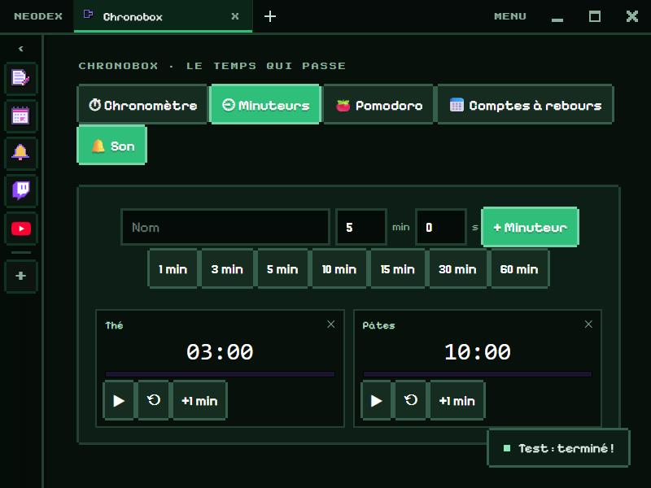

# Chronobox

Everything that counts time, in one place.

*Version française : [README.md](README.md)*

## Stopwatch

To the hundredth of a second, with **pause / resume** and **laps**: each lap shows its time and the total, the fastest in green and the slowest in pink.

## Timers

As many timers as you want, running at the same time: a name, minutes and seconds (or one of the 1 to 60 min shortcuts). Each has its progress bar, **pause**, **reset** and **+1 min**. At the end, three beeps, a message, and the card blinks — even if you're looking at another Chronobox tab.

## Pomodoro

Work, short break, long break, with adjustable lengths (25, 5 and 15 min to start) and a long break every 4 sessions. Phases follow each other on their own with a chime; **⏭ Skip** jumps to the next one.

## Countdowns

Days, hours, minutes and seconds until your important dates (a birthday, holidays, New Year…), sorted by date.

## Good to know

Times are computed from the saved start time: they stay right if you close NeoDex and reopen it later. The **🔔 Sound / 🔕 Muted** button turns the beeps off.

## Data

The stopwatch, the timers, the Pomodoro and the countdowns are kept in the plugin folder. Permission: `storage` only.
