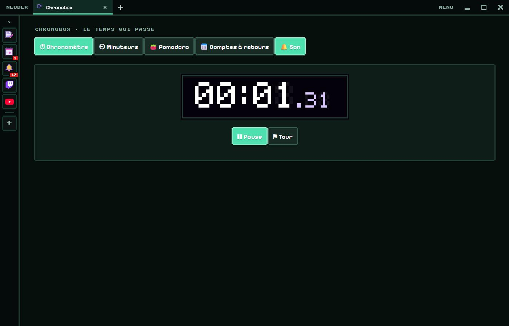

# Chronobox

Tout ce qui compte le temps, au même endroit.

*English version: [README.en.md](README.en.md)*

## Mode concentration (nouveau en 1.3.0)

Pendant le travail du Pomodoro : notifications en silence, sites bloqués, un arbre qui pousse et les statistiques de la semaine.

## Chronomètre

Au centième de seconde, avec **pause / reprendre** et des **tours** : chaque tour affiche son temps et le total, le plus rapide en vert et le plus lent en rose.

## Minuteurs

Autant de minuteurs que tu veux, qui tournent en même temps : un nom, des minutes et des secondes (ou un des raccourcis de 1 à 60 min). Chacun a sa barre de progression, **pause**, **remise à zéro** et **+1 min**. À la fin, trois bips, un message, et la carte clignote — même si tu regardes un autre onglet de Chronobox.

## Pomodoro

Travail, petite pause, grande pause, avec leurs durées réglables (25, 5 et 15 min au départ) et une grande pause toutes les 4 séances. Les phases s'enchaînent toutes seules avec une sonnerie ; **⏭ Passer** saute à la suivante.

## Mode concentration (1.3.0)

Dans l’onglet Pomodoro, coche **Mode concentration** : pendant chaque temps de travail, NeoDex met ses notifications en silence et bloque les sites de la liste (YouTube, Twitch, Reddit, X, TikTok, Instagram et Facebook au départ ; tu la changes comme tu veux). Une page calme dit jusqu’à quelle heure. Pendant les pauses, tout revient. Il faut NeoDex 3.4.2 ou plus, et l’autorisation « Mode concentration ».

Pendant le travail, **un arbre pousse** : graine, pousse, plant, jeune arbre, grand arbre. Chaque temps de travail terminé le plante dans **ta forêt du jour**. **Cette semaine** montre tes minutes de travail jour par jour et le nombre d’arbres plantés.

## Comptes à rebours

Les jours, heures, minutes et secondes jusqu'à tes dates importantes (un anniversaire, des vacances, le nouvel an…), triés par date.

## Bon à savoir

Les temps sont calculés à partir de l'heure de départ enregistrée : ils restent justes si tu fermes NeoDex et le rouvres plus tard. Le bouton **🔔 Son / 🔕 Muet** coupe les bips.

## Données

Le chronomètre, les minuteurs, le Pomodoro et les comptes à rebours sont gardés dans le dossier du plugin. Autorisation : `storage` seulement.

## Version 1.1.0

- Style pixel art des applis récentes : gros chiffres dessinés pixel par pixel sur un écran noir, avec les « 8 » fantômes d'un écran LCD ; les centièmes du chronomètre plus petits, en lilas.
- Les chiffres grandissent avec la fenêtre ; cartes des minuteurs et des comptes à rebours en pixel art, textes plus grands, appli en pleine largeur.

## Minuteur rejoint Chronobox

Le plugin Minuteur est remplacé par l'onglet « Minuteurs » de Chronobox : plusieurs minuteurs en même temps, réglés en heures, minutes et secondes (jusqu'à 99 h), avec des durées toutes prêtes de 1 min à 2 h.
