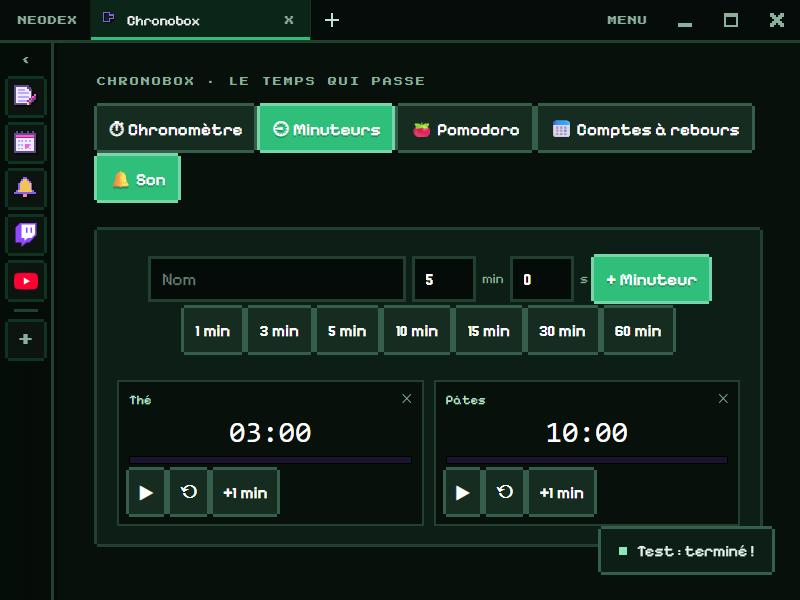

# Chronobox

Tout ce qui compte le temps, au même endroit.

*English version: [README.en.md](README.en.md)*

## Chronomètre

Au centième de seconde, avec **pause / reprendre** et des **tours** : chaque tour affiche son temps et le total, le plus rapide en vert et le plus lent en rose.

## Minuteurs

Autant de minuteurs que tu veux, qui tournent en même temps : un nom, des minutes et des secondes (ou un des raccourcis de 1 à 60 min). Chacun a sa barre de progression, **pause**, **remise à zéro** et **+1 min**. À la fin, trois bips, un message, et la carte clignote — même si tu regardes un autre onglet de Chronobox.

## Pomodoro

Travail, petite pause, grande pause, avec leurs durées réglables (25, 5 et 15 min au départ) et une grande pause toutes les 4 séances. Les phases s'enchaînent toutes seules avec une sonnerie ; **⏭ Passer** saute à la suivante.

## Comptes à rebours

Les jours, heures, minutes et secondes jusqu'à tes dates importantes (un anniversaire, des vacances, le nouvel an…), triés par date.

## Bon à savoir

Les temps sont calculés à partir de l'heure de départ enregistrée : ils restent justes si tu fermes NeoDex et le rouvres plus tard. Le bouton **🔔 Son / 🔕 Muet** coupe les bips.

## Données

Le chronomètre, les minuteurs, le Pomodoro et les comptes à rebours sont gardés dans le dossier du plugin. Autorisation : `storage` seulement.
